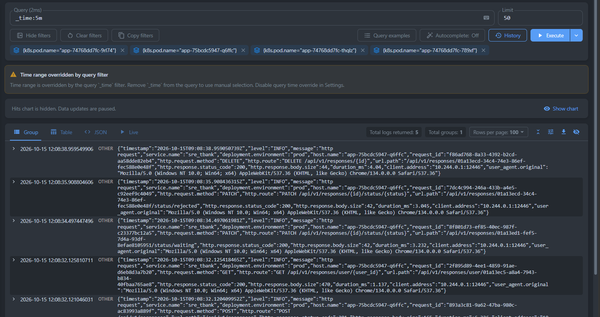
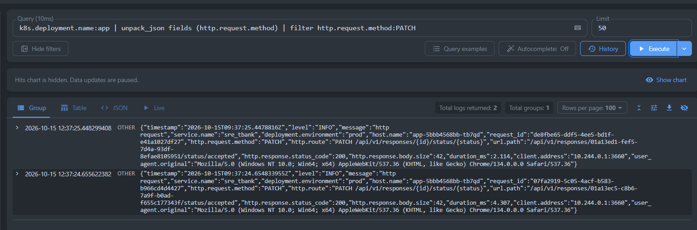
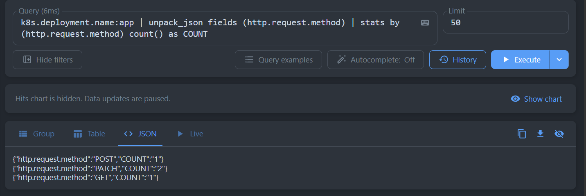
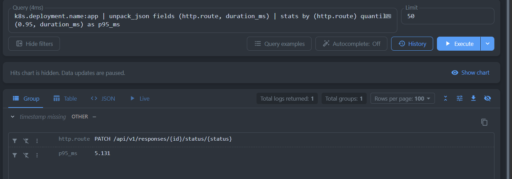
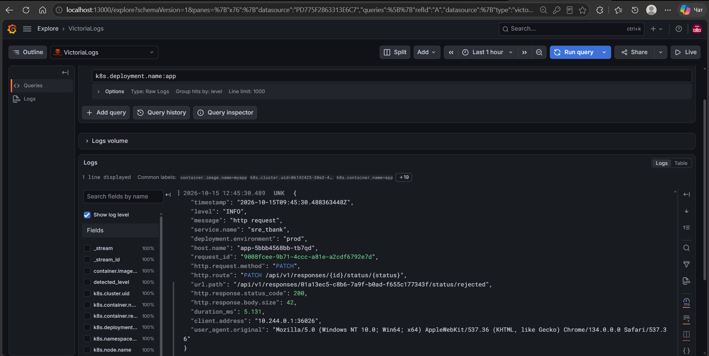
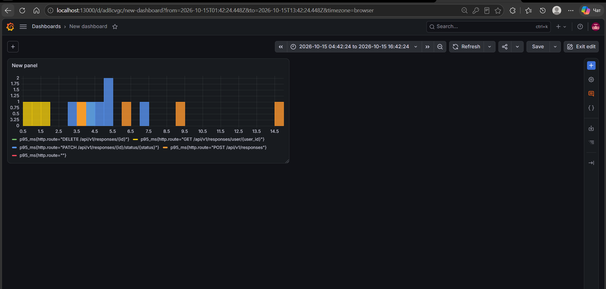

# Отчет за 3 неделю: Логирование

## 1. Логи подов приложения за последние 5 минут

```
_time:5m
```



Запрос выбирает все логи за последние 5 минут, а фильтры по `k8s.pod.name` оставляют только поды приложения `app`. Видно, что каждый HTTP-запрос пишется одной JSON-строкой с полями `request_id`, `http.request.method`, `http.route`, `http.response.status_code`, `duration_ms` и другими.

## 2. Только PATCH-запросы

```
k8s.deployment.name:app | unpack_json fields (http.request.method) | filter http.request.method:PATCH
```



Запрос берёт логи deployment `app`, достаёт из JSON поле `http.request.method` и оставляет только записи с методом `PATCH`. Найдено 2 запроса на смену статуса отклика (`PATCH /api/v1/responses/{id}/status/{status}`), оба завершились с кодом 200.

## 3. Количество запросов по HTTP-методам

```
k8s.deployment.name:app | unpack_json fields (http.request.method) | stats by (http.request.method) count() as COUNT
```



Запрос группирует логи приложения по HTTP-методу и считает число записей в каждой группе. Результат: 2 запроса `PATCH`, 1 `POST` и 1 `GET`.

## 4. 95-й перцентиль длительности по маршрутам

```
k8s.deployment.name:app | unpack_json fields (http.route, duration_ms) | stats by (http.route) quantile(0.95, duration_ms) as p95_ms
```



Запрос достаёт из логов маршрут и длительность обработки и считает для каждого маршрута 95-й перцентиль времени ответа. Для маршрута `PATCH /api/v1/responses/{id}/status/{status}` p95 составил 5.131 мс.


## Бонус: Grafana

### Подключение VictoriaLogs к Grafana

Grafana установлена через Helm с плагином `victoriametrics-logs-datasource`, а VictoriaLogs подключён как источник данных по умолчанию (конфигурация в [values-grafana.yaml](../../values-grafana.yaml)):

```yaml
plugins:
  - victoriametrics-logs-datasource

datasources:
  datasources.yaml:
    apiVersion: 1
    datasources:
      - name: VictoriaLogs
        type: victoriametrics-logs-datasource
        access: proxy
        url: http://vls-victoria-logs-single-server.logging.svc.cluster.local:9428
        isDefault: true
```



На скриншоте в Grafana Explore выполнен запрос `k8s.deployment.name:app` к VictoriaLogs. Логи приложения приходят разобранными: видны поля JSON-записи и метки Kubernetes (`k8s.deployment.name`, `k8s.namespace.name`, `k8s.node.name` и другие).

### Дашборд

Добавил базовый дашборд с панелью p95 времени ответа (`duration_ms`).

